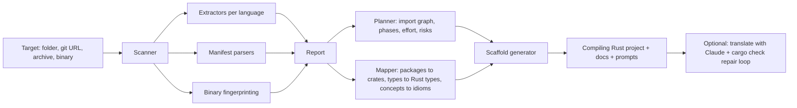

# convert-to-rust (`c2r`)

**Reverse engineer any project, then rebuild it in Rust.**

`c2r` reads a codebase (a folder, a single file, a git URL, an archive or a compiled binary) and recovers its structure: modules, functions, types, HTTP routes, dependencies, entry points and the language features that need care in Rust. It then gives you the option to **rebuild the project in Rust**. It generates a Cargo project that **compiles and runs on day one**, with typed stubs, an axum router, a library mapping, a phased migration plan and per-module translation prompts. Optionally, it translates every module with Claude and repairs compiler errors in a loop.

```text
$ c2r convert ./python-flask-loans

convert-to-rust: python-flask-loans (source directory)
------------------------------------------------------------
  Primary language : Python
  Frameworks       : Flask
  Code lines       : 140 (Python 140)
  Functions/methods: 15
  Types            : 6
  HTTP routes      : 5
  Entry points     : app.py
  Dependencies     : 5 (5 mapped to Rust crates, +1 detected from imports)
  Migration plan   : 5 phase(s), ~9 h estimated
  Watch out for    : Decorators / annotations; null / None / nil; Exceptions / try-catch

Rebuild this project in Rust in 'python-flask-loans-rs'?  [Y]es / [a]i-translate too / [n]o: y

Rust project generated: python-flask-loans-rs
  models     : 6 structs/enums, 0 traits
  modules    : 3 (13 typed stubs)
  routes     : 5 axum routes (answer 501 until ported)

Running cargo check on the generated project ... ok - it compiles.
```

---

## Why

Rewrites fail when they start from a blank page. `c2r` starts from the code you already have:

1. **Understand.** It gives you an inventory of what the system actually does, with evidence (file and line for every symbol and route).
2. **Plan.** It orders the port by dependencies, maps every library to a Rust crate, flags the risky parts (reflection, `eval`, global state, manual memory) and estimates effort.
3. **Rebuild.** It generates a compiling Rust skeleton that mirrors the original. Each stub carries the original code next to it, so a person or an LLM can fill it in one module at a time.

## Install

Needs a recent Rust toolchain (1.85+).

```bash
# from GitHub
cargo install --git https://github.com/om24485-beep/convert-to-rust

# or from a local checkout / downloaded zip (no network access to GitHub needed)
cargo install --path .
```

To build without the optional AI feature (no HTTP client compiled in), add `--no-default-features`.

## Usage

| Command | What it does |
|---|---|
| `c2r analyze <target>` | Reverse engineers the target and prints a summary. `--json` and `--markdown` write full reports. |
| `c2r plan <target>` | Writes a phased Rust migration plan in Markdown. |
| `c2r scaffold <target> -o out` | Generates the Rust project (no questions asked). |
| `c2r convert <target>` | Analyzes, **asks whether to rebuild in Rust**, scaffolds, optionally AI-translates, then runs `cargo check`. |
| `c2r translate <rust-dir>` | Translates the stubs of a scaffolded project with Claude in plan order, then loops on `cargo check`. |
| `c2r mappings [query]` | Browses the package-to-crate knowledge base (`c2r mappings pandas`). |

`<target>` can be any of:

| Input | Examples | What happens |
|---|---|---|
| Source folder or single file | `./my-app`, `script.py` | Full analysis and scaffold |
| Git URL | `https://github.com/user/repo` | Shallow clone, then the same as a folder |
| Archive | `.zip .jar .war .apk .whl .nupkg .tar.gz .tgz` | Safely extracted (zip-slip and size guarded), then analyzed |
| Compiled binary | ELF, PE (`.exe`/`.dll`), Mach-O | Format, architecture, toolchain fingerprint, linked libraries, imports and exports, interesting strings |

### Examples

```bash
c2r analyze https://github.com/spring-projects/spring-petclinic
c2r convert ./legacy-node-api -o api-rs --yes
c2r scaffold app.jar -o app-rs           # lists the JVM classes and tells you to decompile first
c2r plan ./backend -o MIGRATION.md
ANTHROPIC_API_KEY=sk-... c2r translate api-rs --fix-rounds 2
```

## What you get

```text
my-app-rs/
├── Cargo.toml          # deps the scaffold needs + commented suggestions mapped from the original
├── src/
│   ├── main.rs         # tokio + axum server (web apps) or a plain main
│   ├── models.rs       # every class/interface/struct/enum as serde types
│   ├── routes.rs       # every discovered HTTP route; each answers 501 with JSON until ported
│   └── ported/         # one module per source file, mirroring the original tree
│       └── loans/emi.rs
├── ANALYSIS.md         # what was found: languages, routes, types, dependency graph (Mermaid)
├── MIGRATION.md        # strategy, phases, library mapping, concept guide, definition of done
├── prompts/            # one self-contained translation prompt per module, in plan order
├── c2r-report.json     # full machine-readable analysis
└── c2r-manifest.json   # source file <-> Rust module map (used by `c2r translate`)
```

A generated stub looks like this. The signature types are mapped, and the original code sits inside the stub:

```rust
/// Ported from `loans/emi.py:13`.
/// Original: `def emi(principal: Decimal, annual_rate: Decimal, tenure_months: int) -> Decimal:`
pub fn emi(principal: rust_decimal::Decimal, annual_rate: rust_decimal::Decimal, tenure_months: i32) -> rust_decimal::Decimal {
    // ---- original (Python) ----
    // def emi(principal: Decimal, annual_rate: Decimal, tenure_months: int) -> Decimal:
    //     r = monthly_rate(annual_rate)
    //     ...
    // ---- end original ----
    todo!("port `emi` from loans/emi.py:13")
}
```

And the models keep the original wire format:

```rust
#[derive(Debug, Clone, Serialize, Deserialize)]
pub struct User {
    pub id: String,
    #[serde(rename = "displayName")]
    pub display_name: String,
    pub role: Role,
    #[serde(rename = "lastLoginAt")]
    #[serde(default)]
    pub last_login_at: Option<chrono::DateTime<chrono::Utc>>,
}
```

### Things the generator gets right

- **It always compiles.** Recursive types get `Box` only where there is a real cycle. Map keys and set elements are kept hashable. Names that collide with Rust keywords, prelude types or axum imports are renamed.
- **The wire format is preserved.** `#[serde(rename)]` keeps camelCase and PascalCase field names, Go `json:"..."` tags and enum values (`LoanStatus.APPROVED = "approved"`).
- **Money is never `f64`.** `Decimal` and `BigDecimal` map to `rust_decimal::Decimal`.
- **Error idioms translate.** Go `(T, error)` becomes `anyhow::Result<T>`, and `null`/`None`/`nil`/`T?` becomes `Option<T>`.
- **Inheritance becomes composition.** A known base class becomes a `#[serde(flatten)]` field, and interfaces become traits.
- **Routes are normalized for axum 0.8.** `:id`, `<int:id>` and `{id:regex}` all become `{id}`, and Express `app.use('/prefix', router)` mounts are resolved. Overlapping routes that would make axum panic are merged or dropped, with a note.

## AI translation (optional)

```bash
export ANTHROPIC_API_KEY=...
c2r translate my-app-rs                 # all modules, dependencies first
c2r translate my-app-rs --only emi      # just matching modules
c2r translate my-app-rs --dry-run       # show the order
```

For each module, `c2r` sends the prompt from `prompts/` (requirements, library mapping, concept guidance, shared models, the skeleton and the original source). It writes the returned file over the stub and keeps a backup in `.c2r/backup/`. Then it runs `cargo check` and, for up to `--fix-rounds` rounds, sends compiler errors back for repair. The model defaults to `claude-sonnet-5-5`; you can override it with `--model` or `C2R_MODEL`. `ANTHROPIC_BASE_URL`, `HTTPS_PROXY` and `NO_PROXY` are honored.

No API key? The prompts are plain Markdown. Paste them into any LLM, or use them as a checklist for a human port.

## Supported languages

| Language | Functions & methods | Types & fields | Routes | Manifests |
|---|---|---|---|---|
| Python | yes (async, decorators, `self`) | classes, dataclasses, Pydantic-style fields, Enum | Flask, FastAPI, Django `urls.py` | requirements*.txt, pyproject (PEP 621 + Poetry), setup.py, Pipfile |
| JavaScript / TypeScript | functions, arrow functions, class methods | classes, interfaces, object types, enums | Express (with mounts), Fastify, Koa, NestJS | package.json |
| Go | functions, receiver methods | structs (json tags), interfaces | net/http (1.22 patterns), Gin, Echo, chi, Fiber | go.mod |
| Java | methods, constructors | classes, records, interfaces, enums | Spring MVC | pom.xml, build.gradle |
| C# | methods, constructors, expression bodies | classes, records, properties | ASP.NET Core attributes | *.csproj |
| Kotlin | functions, suspend, extensions | classes, data classes | - | build.gradle.kts |
| C / C++ | function definitions, `Class::method` | structs, classes | - | - |
| Ruby | methods, `self.` methods | classes, modules, attr_accessor | Rails routes, Sinatra | Gemfile |
| PHP | functions, methods | classes, typed properties | Laravel | composer.json |

The knowledge base maps **nearly 1,000 package names (106 rules) across npm, PyPI, Maven, Go, RubyGems, Composer and NuGet** to Rust crates (web frameworks, ORMs, drivers, queues, auth, logging, data science, cloud SDKs and more). It also covers standard-library modules (`asyncio`, `net/http`, `java.time`, and so on).

## Tested on real projects

Every one of these was scaffolded straight from its git URL, and the generated Rust project compiled without edits:

| Repository | Language | Functions/methods | Types | Routes | Rust stubs |
|---|---|---:|---:|---:|---:|
| dotnet-architecture/eShopOnWeb | C# | 441 | 257 | 26 | 331 |
| fastapi/full-stack-fastapi-template | TypeScript + Python | 393 | 156 | 23 | 307 |
| sinatra/sinatra | Ruby | 883 | 269 | - | 565 |
| gin-gonic/examples | Go | 150 | 17 | 68 | 142 |
| spring-projects/spring-petclinic | Java | 103 | 50 | 18 | 87 |
| android/sunflower | Kotlin | 120 | 58 | - | 98 |
| gothinkster/node-express-realworld-example-app | TypeScript | 32 | 11 | 18 | 32 |
| antirez/kilo | C | 35 | 5 | - | 35 |
| laravel/laravel | PHP | 14 | 8 | 1 | 12 |

The repo's own [`examples/`](examples) folder holds a Flask loan API, an Express users API and a Gin ledger service. `cargo test` checks their scaffolds, and `cargo test -- --ignored` compiles them.

## How it works



- **Extractors** are deliberately tolerant, regex- and brace/indent-based, with no compiler toolchains required. A missed symbol costs one stub, never the whole run. They also count "concepts" such as `eval`, reflection, goroutines and channels, inheritance and manual memory, which feed the plan's guidance.
- **The planner** builds the internal import graph, layers modules with a longest-path order (breaking cycles), puts entry points last and tests in their own phase. It estimates hours from lines of code, symbols and risk.
- **The mapper** turns source types into Rust types (`Optional[List[int]]` becomes `Option<Vec<i32>>`, `Promise<User | null>` becomes `Option<User>`, `map[string][]byte` becomes `HashMap<String, Vec<u8>>`, `List<BigDecimal>` becomes `Vec<Decimal>`).

## Limitations

- c2r recovers **structure, not semantics.** Function bodies are carried over as comments, not compiled. Use `c2r translate` or a human to port the logic, and use the original tests as the oracle.
- Extraction is heuristic. Unusual formatting or metaprogramming-heavy code can be missed or misread. Check `ANALYSIS.md`.
- Binaries are fingerprinted, not decompiled. For real decompilation, run Ghidra or IDA (or a reverse-engineering tool such as REA) first, then feed the recovered source to c2r. JVM archives are inventoried, so decompile them with CFR, Vineflower or JADX and re-run.
- Effort estimates are rough heuristics, intended for ordering and sizing, not for quoting.

## Development

```bash
cargo test                    # unit + end-to-end tests on examples/
cargo test -- --ignored       # also compiles every generated example (needs crates.io)
cargo clippy --all-targets
```

The code is organized like this: `scanner` (input and walk), `extract` (per-language parsers), `deps` (manifests), `binary` (ELF/PE/Mach-O), `mapping` (knowledge base and type mapper), `plan`, `scaffold`, `prompts`, `report` and `ai`. Adding a package mapping is one line in `mapping::RULES`.

## License

MIT, see [LICENSE](LICENSE).
